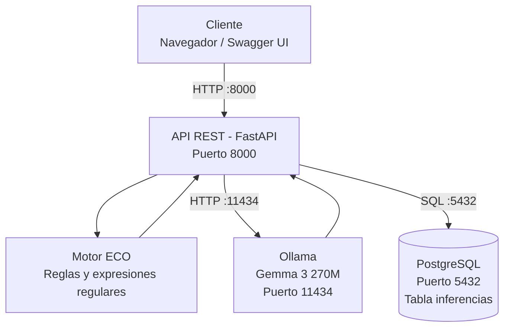

# Manual técnico – Clasificador de mensajes de commit

## 1. Arquitectura

El sistema está compuesto por un cliente, una API REST desarrollada con FastAPI, dos motores de clasificación y una base de datos PostgreSQL. La arquitectura permite clasificar mensajes de commit mediante reglas predefinidas o utilizando un modelo de lenguaje local ejecutado con Ollama.

### 1.1 Diagrama de arquitectura

### 1.2 Componentes

| Componente | Descripción | Puerto |
|---|---|---|
| Cliente | Permite enviar mensajes de commit y consultar resultados mediante navegador o Swagger. | — |
| API REST | Recibe solicitudes, selecciona el motor de clasificación, registra las inferencias y devuelve resultados. | 8000 |
| Motor ECO | Clasifica mensajes mediante reglas y expresiones regulares, sin utilizar un modelo de inteligencia artificial. | Interno |
| Ollama | Ejecuta el modelo Gemma 3 270M de forma local para clasificar los mensajes. | 11434 |
| PostgreSQL | Almacena las inferencias realizadas, incluyendo entrada, salida, motor, modelo y latencia. | 5432 |

### 1.3 Flujo de funcionamiento

1. El cliente envía un mensaje de commit a la API REST.
2. FastAPI recibe la solicitud a través del puerto 8000.
3. La API determina el motor de clasificación que se utilizará.
4. Si se selecciona ECO, se aplican reglas y expresiones regulares al texto.
5. Si se selecciona Ollama, la API envía el mensaje al modelo local Gemma 3 270M mediante el puerto 11434.
6. El resultado de la clasificación regresa a la API.
7. La API registra la información de la inferencia en PostgreSQL mediante el puerto 5432.
8. Finalmente, la API devuelve al cliente la categoría obtenida, el motor utilizado, el modelo y la latencia.

---

## 2. Seguridad

### 2.1 Puertos utilizados y exposición

El sistema utiliza los siguientes puertos para la comunicación entre sus componentes:

| Puerto | Componente | Uso | Exposición prevista |
|---|---|---|---|
| 8000 | FastAPI | Recibir solicitudes HTTP de los clientes. | Clientes autorizados o entorno local de desarrollo. |
| 11434 | Ollama | Procesamiento de mensajes mediante el modelo local. | Acceso interno desde la API. |
| 5432 | PostgreSQL | Consultas y almacenamiento de inferencias. | Acceso interno desde la API. |

Los puertos de Ollama y PostgreSQL no deben exponerse directamente a Internet, ya que son servicios internos del sistema. El acceso a la API también debe restringirse a los usuarios autorizados según el entorno de despliegue.

### 2.2 Roles de la base de datos

Se utilizan dos tipos de roles para administrar el acceso a PostgreSQL:

**Usuario de aplicación (`app_ia`):**

- Utilizado por la API para conectarse a PostgreSQL.
- Permite realizar las operaciones necesarias para registrar y consultar inferencias.
- No debe tener permisos administrativos innecesarios.
- No debe tener permisos para administrar usuarios ni modificar la configuración general del servidor.

**Usuario administrador:**

- Encargado de tareas administrativas de PostgreSQL.
- Puede realizar tareas de configuración, mantenimiento, gestión de usuarios y administración de la base de datos.
- No debe utilizarse para las operaciones habituales de la API.

Se aplica el principio de mínimo privilegio, otorgando a cada rol únicamente los permisos requeridos para sus funciones.

### 2.3 Manejo de secretos

Las credenciales y configuraciones sensibles se almacenan mediante variables de entorno definidas en el archivo `.env`.

El archivo `.env` contiene información como las contraseñas de la base de datos y no debe subirse al repositorio Git.

Para documentar las variables de configuración se utiliza `.env.example`, el cual contiene valores de ejemplo sin incluir credenciales reales.

El archivo `.gitignore` incluye `.env` para evitar que sea agregado accidentalmente al repositorio.

### 2.4 Procedimiento ante filtración de contraseña

En caso de que una contraseña sea filtrada o expuesta, se realizarían las siguientes acciones:

1. Cambiar inmediatamente la contraseña comprometida.
2. Actualizar las variables de entorno y las configuraciones que utilicen la credencial.
3. Revocar o restringir el acceso de la cuenta comprometida cuando sea necesario.
4. Revisar los registros para identificar posibles accesos no autorizados.
5. Si el secreto fue publicado en GitHub, retirar la credencial expuesta y limpiar el historial del repositorio cuando corresponda.
6. Verificar el funcionamiento de los servicios con la nueva contraseña